  <a href="https://www.afifalamgir.com"><b>Website</b></a>&nbsp;&nbsp;·&nbsp;&nbsp;
  <a href="https://www.linkedin.com/in/afif-alamgir/">LinkedIn</a>&nbsp;&nbsp;·&nbsp;&nbsp;
  <a href="https://medium.com/@afifalamgir">Medium</a>&nbsp;&nbsp;·&nbsp;&nbsp;
  <a href="https://www.researchgate.net/profile/Afif-Alamgir">ResearchGate</a>&nbsp;&nbsp;·&nbsp;&nbsp;
  <a href="https://instagram.com/__.lizel.__">Instagram</a>&nbsp;&nbsp;·&nbsp;&nbsp;
  <a href="mailto:afifalamgir@gmail.com">Email</a>

Software Engineer at <b>Techneth</b> &nbsp;·&nbsp; open to selected projects worldwide

 

| | | | |
|:--|:--|:--|:--|
| `01` | **[SaaS platforms](https://www.afifalamgir.com/services/saas-platform-development)** | Multi-tenant apps with subscriptions, billing and role-based access | Next.js · React · PostgreSQL |
| `02` | **[CRM & automation](https://www.afifalamgir.com/services/crm-marketing-automation)** | Custom CRM dashboards, lead tracking, Meta / Google API integrations | React · Node.js · Meta API |
| `03` | **[AI integration](https://www.afifalamgir.com/services/ai-integration)** | RAG pipelines, LLM features and agent workflows wired into real products | Python · FastAPI · LLMs |
| `04` | **[APIs & backend](https://www.afifalamgir.com/services/api-backend-engineering)** | REST and GraphQL APIs, webhooks, background jobs, schema design | Node.js · Express · Python |
| `05` | **[Web applications](https://www.afifalamgir.com/services/web-application-development)** | Fast, SEO-ready client portals, dashboards and consumer platforms | Next.js · TypeScript |
| `06` | **[Mobile apps](https://www.afifalamgir.com/services/mobile-app-development)** | iOS and Android from one codebase, prototype to store launch | Flutter · Dart · Firebase |

 

  

> **Optimizing American Sign Language Recognition with Binarized Neural Networks**
> Springer Nature · Conference paper · 2024
>
> A network that restricts weights and activations to **+1 and −1**, benchmarked against full-precision CNNs for ASL recognition. Competitive accuracy at a fraction of the memory and compute, built for edge devices.
>
> [Read on Springer ↗](https://link.springer.com/chapter/10.1007/978-3-032-11335-1_27) &nbsp;·&nbsp; `DOI 10.1007/978-3-032-11335-1_27`

 

| | |
|:--|:--|
| `2026.06.01` | [Next.js Server Components: the "simplified" lie we're all falling for?](https://www.afifalamgir.com/blog/nextjs-server-components-simplified-lie) |
| `2026.05.17` | [From database dread to deployment delight: my Supabase journey](https://www.afifalamgir.com/blog/from-database-dread-to-deployment-delight-my-supabase-journey-as-an-indie-hacker) |
| `2026.05.16` | [Next.js: the frontend king that might be making us over-engineer](https://www.afifalamgir.com/blog/nextjs-frontend-king-over-engineer-hot-take) |
| `2026.05.15` | [AI agents are a trap: why I'm still writing vanilla code](https://www.afifalamgir.com/blog/ai-agents-trap-vanilla-code-2026) |

<a href="https://www.afifalamgir.com/blog">All posts →</a>

  

Dhaka · UTC+6 &nbsp;·&nbsp; © 2026 Afif Alamgir

